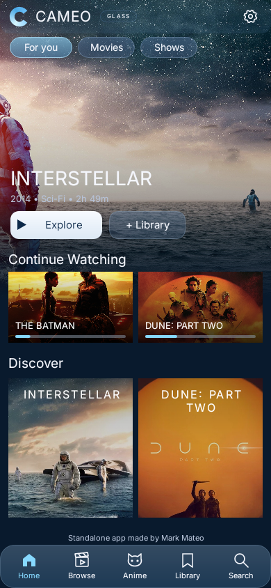
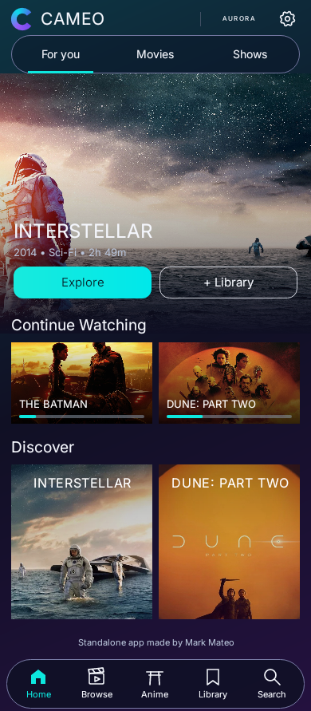
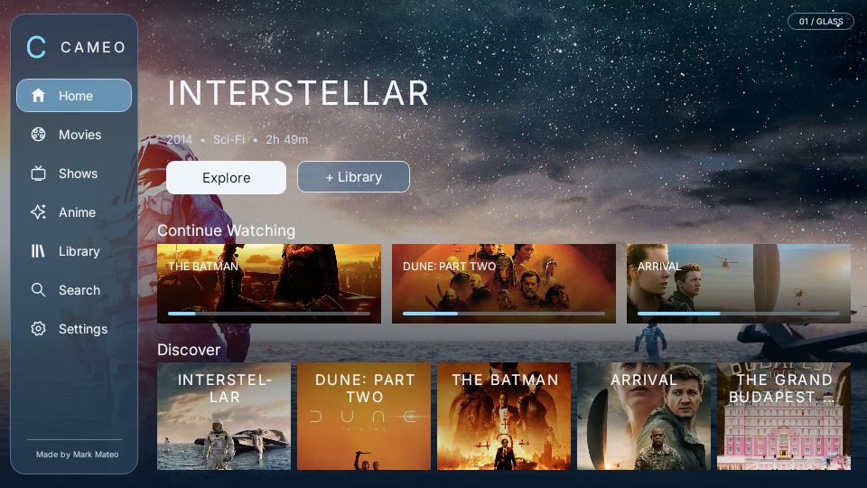

# Cameo for Android

**Standalone app made by Mark Mateo. Based on the original POV Kodi add-on by [kodifitzwell](https://github.com/kodifitzwell/repo).**

Cameo is the Android continuation of POV, with native interfaces for phones, foldables, tablets and Android TV. Kodi is not required. The current development version is **0.4.0-preview / code 7**, Android 8.0 or later. The launcher name is **Cameo**. Its existing Android package identifier is retained so an update can preserve an installed POV library and connections.

This update ports desktop features from the supplied Cameo Windows 0.2.4 source and the available Mac 0.2.1 source. [The comparison and implementation ledger](docs/CAMEO_DESKTOP_ANDROID_PARITY.md) records the source evidence, Android adaptations and remaining boundaries. APKs, matching source and checksums are distributed through [GitHub releases](https://github.com/MM-482/pov-android-tv/releases); the versioned Cameo destination is [0.4.0-preview](https://github.com/MM-482/pov-android-tv/releases/tag/v0.4.0-preview).

[Setup](docs/INSTALL_0.4.0.md) · [Changes](docs/RELEASE_NOTES_0.4.0.md) · [Validation](docs/AUDIT_0.4.0.md) · [Privacy](docs/PRIVACY.md) · [Embedded VLC](docs/LIBVLC.md)

## What is included

- Native mobile navigation, touch controls, responsive cover/unfolded layouts, and five Cameo themes: **Glass, Cinema, Slate, Pearl and Aurora**. TV has five corresponding layouts. Previous POV themes migrate to Cameo; only the new themes appear in Appearance. Theme references and native captures are separate; reference images are used by the appearance picker, never as an interactive Home screen.
- Local video and folder import through Android's document picker, explicit import of videos shared/opened from another app, cancellable folder scanning, direct stream opening, a local watchlist, and named playlists with reorder/remove/play-from-here actions.
- Explicit direct-file downloads with a chosen save location, progress, cancellation, interrupted-job status, and completed-file playback. HLS/DASH manifests and error pages are rejected as offline movies. Existing nonempty documents are not silently overwritten. Keep Cameo open until transfers complete; restart does not resume a partial transfer.
- Cinemeta movie/show discovery with genre selection, search and paging. Public metadata has a bounded offline cache with a stale-data notice. This cache does not contain offline videos or account pages.
- Dedicated anime discovery, separate movies/series, exact seasons and episodes, Specials, and explicit account-list progress/status/score edits through AniList, MyAnimeList and Kitsu.
- Playback through your own TorBox, Real-Debrid, AllDebrid, Premiumize, Offcloud, Debrid-Link, put.io or Easynews account. Named playback-account profiles can be switched independently. Seedr uses its eligible-plan WebDAV service.
- Plex, Jellyfin, Emby and WebDAV connections, with exact file/edition selection and fresh account-bound playback resolution. Server folders follow the desktop source's 250-item request limit; this preview does not promise unlimited library pagination or server transcoding.
- Multiple Stremio-compatible add-ons: install, refresh, enable/disable and remove manifests; browse supported catalogs; preserve exact custom media/episode identities; choose sources, quality and subtitle files. Unsupported required extras or external-only streams receive an explanation.
- Existing Trakt linking, lists, Up Next and reporting, plus independent MDBList and Simkl support. Optional MDBList/Simkl automatic reporting starts Off and requires account-specific consent. Pending reports can be reviewed and discarded. Simkl watchlist removal is withheld where its API would also remove shared watch history.
- Media3 or embedded VLC, chosen in Settings for the next video. Fullscreen and in-app mini use the same playback session. Integrated Stop, audio/subtitle selection, subtitle timing/appearance, speed, volume, sleep timer, chapters where available, playback details, explicit Up Next and Android picture-in-picture are included. PCM volume amplification remains engine/device dependent.
- Explicit VLC Chromecast discovery and route selection for compatible unprotected sessions. Discovery is bounded and user initiated. Selecting a route is distinct from confirming receiver video; real receiver validation is recorded separately. This does not implement Apple's AirPlay protocol.
- Independent launcher-icon choices and a deliberate, sanitized troubleshooting-report export. Reports are never uploaded automatically.

**Bring your own accounts and media access.** No owner login, subscription, password, account token, API key, Trakt Client ID or Simkl Client ID is supplied in the public build. Account adapter fixtures are controlled tests; they do not certify every private account, service plan, format, receiver or device. No subscriptions or media are supplied by Cameo.

## App previews

These are controlled renders of Cameo's native Android views with public sample artwork and synthetic progress. They are app-canvas previews, not photographs or physical-device screenshots. The [validation record](docs/AUDIT_0.4.0.md) separately describes the real Sony and phone checks.

Mobile — Glass and Aurora:

<p> </p>

TV — Glass:



All five mobile previews: [Glass](docs/previews/0.4.0/mobile/01-glass-native-390x844.png) · [Cinema](docs/previews/0.4.0/mobile/02-cinema-native-390x891.png) · [Slate](docs/previews/0.4.0/mobile/03-slate-native-390x891.png) · [Pearl](docs/previews/0.4.0/mobile/04-pearl-native-390x891.png) · [Aurora](docs/previews/0.4.0/mobile/05-aurora-native-390x891.png).

All five TV previews: [Glass](docs/previews/0.4.0/tv/01-glass-native-960x540.png) · [Cinema](docs/previews/0.4.0/tv/02-cinema-native-960x540.png) · [Slate](docs/previews/0.4.0/tv/03-slate-native-960x540.png) · [Pearl](docs/previews/0.4.0/tv/04-pearl-native-960x540.png) · [Aurora](docs/previews/0.4.0/tv/05-aurora-native-960x540.png).

## Design references

[Five mobile concepts](design/cameo-mobile-concepts-2026-11-02/index.html) · [Five TV concepts](design/cameo-android-concepts-2026-11-02/index.html)

The mobile target requested by the owner is a Z Fold 8. Runtime dimensions drive layout. Controlled logical viewports are separate from the real owner-operated fold recorded in the validation report; they do not establish a hardware specification or every possible window state. Generated concepts define the intended appearance. Dynamic titles, artwork, accessibility text size and system bars vary with real content and device settings; exact rendered comparisons belong in the validation record.

## Build from source

Use Windows PowerShell in this project folder:

```powershell
./scripts/bootstrap.ps1
./scripts/build.ps1
```

Bootstrap provisions verified local build tools. The build script compiles the app, runs its automated tests and Android lint, and records the build-output location in a private tooling file. The SDK, caches, machine paths, signing keys and installed account data are excluded from source packages. See [LibVLC build/source instructions](docs/LIBVLC.md) for the unchanged embedded native library and corresponding-source companion.

## Attribution and licenses

Cameo's Android application source is distributed under GNU GPL version 3. Mark Mateo created this standalone adaptation; the original POV Kodi add-on is by kodifitzwell, who is not affiliated with this Android application. Original assets retain their attribution. Cameo's five launcher icons are carried over from the supplied desktop source. Current native theme text uses Inter, Instrument Serif and selected platform styles. Cormorant Garamond remains bundled for the retained historical renderer; its Premiere theme is no longer selectable. All three bundled font families retain their SIL Open Font Licenses. See [font notices](app/src/main/assets/FONT_NOTICES.md), [application notices](app/src/main/assets/NOTICE.txt), [LICENSE](LICENSE) and [VLC provenance](docs/LIBVLC.md).

Historical 0.3.0 device results remain in [the earlier audit](docs/AUDIT_0.3.0.md). They are not proof that this 0.4.0 candidate passed a later physical-device run.
