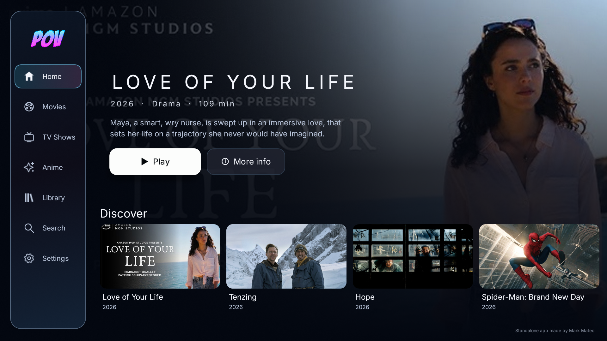
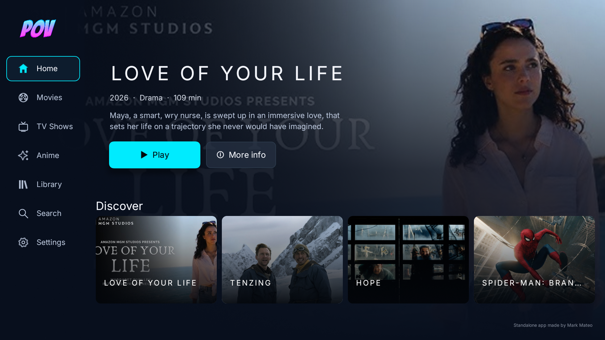
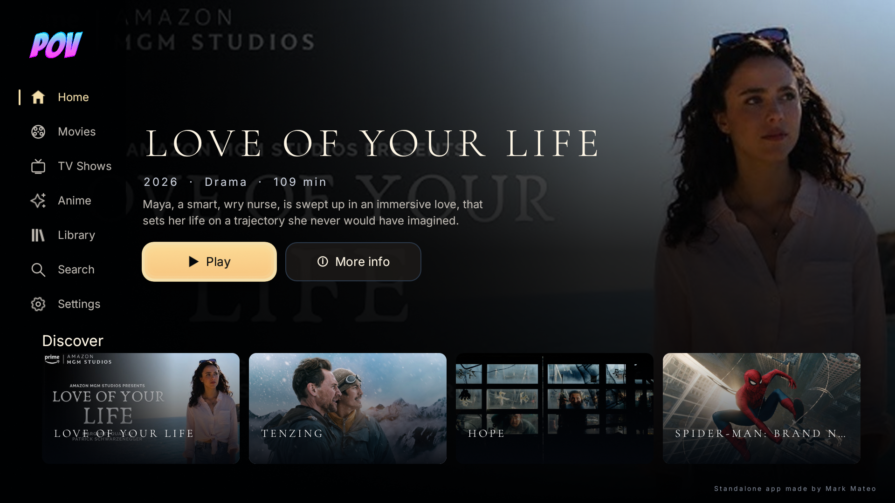
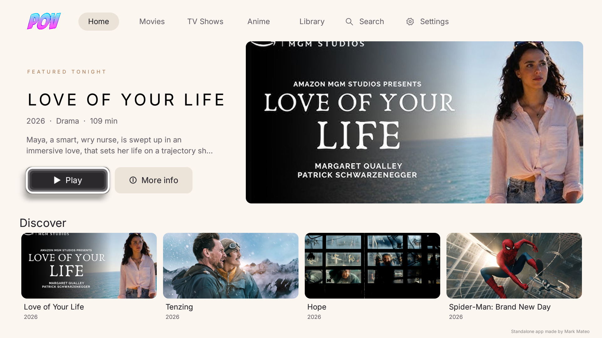
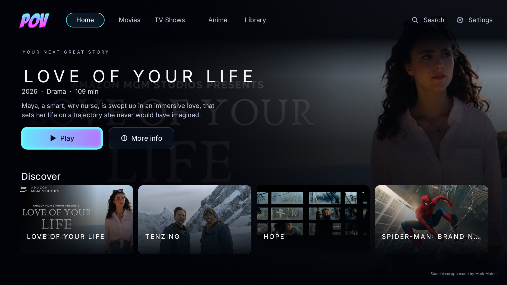
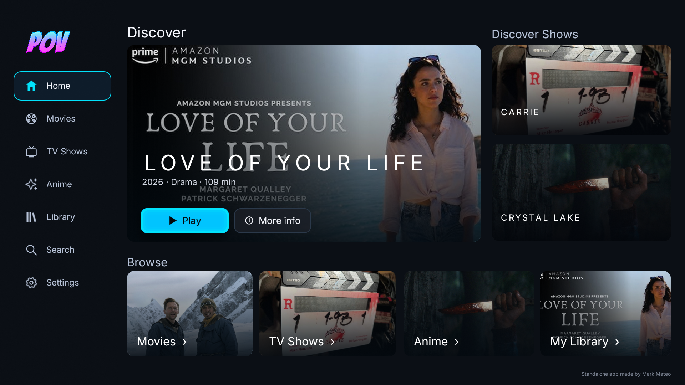
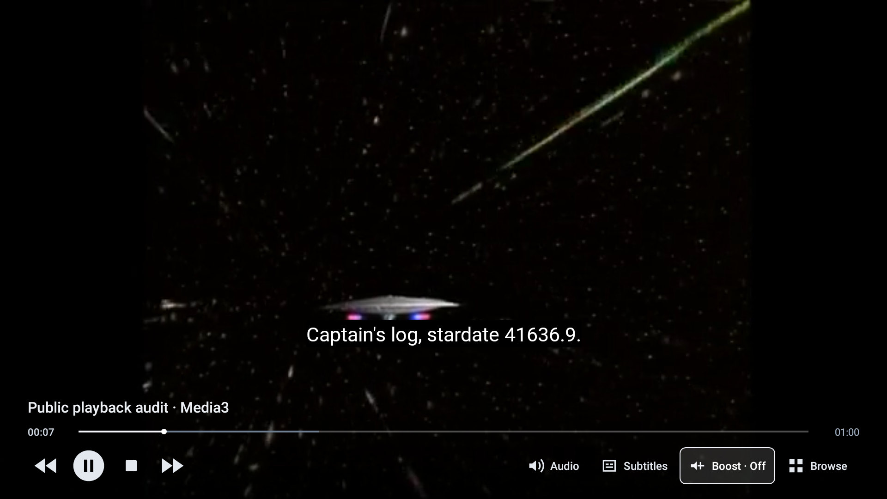
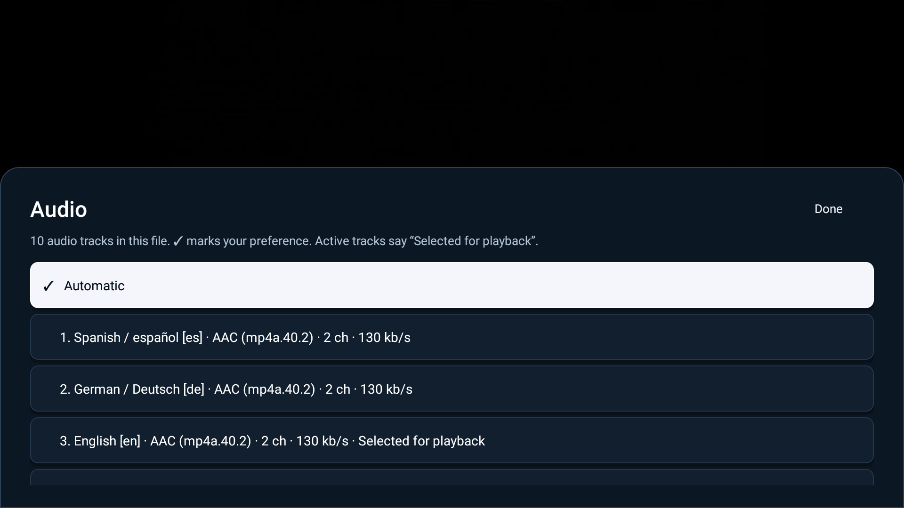

# POV Standalone for Android TV

**Standalone app made by Mark Mateo. Based on the original POV Kodi add-on by [kodifitzwell](https://github.com/kodifitzwell/repo).**

An independent native Android TV app for browsing movies, shows, and anime, selecting sources through your own playback-service accounts, and playing them inside POV. Kodi is not installed, embedded, or required at runtime. The current working source is **0.3.0-preview** (`versionCode 6`) for Android TV 8.0 or later. The published GitHub release remains [0.2.2-preview](https://github.com/MM-482/pov-android-tv/releases/tag/v0.2.2-preview); this VLC-enabled update is still being validated locally.

[0.3.0 setup](docs/INSTALL_0.3.0.md) · [Change notes](docs/RELEASE_NOTES_0.3.0.md) · [Validation record](docs/AUDIT_0.3.0.md) · [Privacy](docs/PRIVACY.md) · [LibVLC source/licensing](docs/LIBVLC.md)

## What the 0.3.0 source includes

- Six selectable native themes: **Glass, Essential, Premiere, Atelier, Horizon, and Studio**. Navigation, title actions, cards, and focus remain real TV controls; catalog artwork, saved progress, and episode identities supply the content.
- **Media3 or embedded VLC**, selected for the next video. Fullscreen and the in-app mini-player share one playback session. A compact square Stop button sits between Play/Pause and Forward; one Right press from Play/Pause reaches it.
- Local **Continue Watching** removal through hold-Select or Menu, preserving resume data and external watched history. Intentionally playing the title again restores its eligibility.
- Preferred-language subtitles, Android document-picker import, and explicit search/download through **OpenSubtitles, SubDL, and SubSource**, using your credentials.
- Independent playback accounts for **TorBox, Real-Debrid, AllDebrid, Premiumize, Offcloud, and experimental Easynews**, with explicit source and video-version choices.
- Existing **Trakt** linking, lists, identified playback tracking, and queued updates; independent **MDBList** and **Simkl** library/actions. Automatic MDBList/Simkl reporting is **Off by default** and requires separate consent for each connected account.
- Movie/show discovery through Cinemeta, a dedicated Kitsu anime section, search/details, selected-season episode lists, and Stremio-compatible source discovery.

**Bring your own accounts.** POV supplies no subscriptions, service passwords, account tokens, API keys, Trakt Client ID, or Simkl Client ID. Trakt and Simkl require your own registered public application identifiers. The [setup guide](docs/INSTALL_0.3.0.md) explains these preview requirements.

## Six appearances

Open **Settings → Appearance → Themes**. Glass is the fresh-install default. Existing appearance choices migrate to their closest new layout without clearing account connections, playback preferences, or viewing progress.

| Theme | Native composition |
| --- | --- |
| Glass | A floating glass-style rail, expansive artwork, white actions, and soft white focus. |
| Essential | A fixed dark rail, cyan actions/focus, and aligned landscape watching cards. |
| Premiere | Immersive artwork, a large serif feature title, warm gold focus, and a wide lower card row. |
| Atelier | An ivory canvas, horizontal navigation, and a split text/artwork feature. |
| Horizon | Horizontal navigation, wide artwork, and cyan/violet actions and focus. |
| Studio | A large watching feature, an episode column, and browse shortcuts in a dashboard composition. |

The [approved six-design gallery](design/concepts-2026-10-26/index.html) contains generated references with fictional sample titles. The picker uses those images as previews; the running Home screen uses actual catalog and account content. Android 8 glass depth uses tinted gradients and borders. Inter and Cormorant Garamond are bundled locally with their original SIL Open Font Licenses and [source attribution](app/src/main/assets/FONT_NOTICES.md); no runtime font-service request is made.

The [Sony comparison gallery](docs/previews/0.3.0/index.html) now places all six reviewed actual guest Home captures beside the approved concepts. The captures below come from the `582cec…6273` candidate on the Sony Android 8 TV after its viewport-clipping fix. They show public discovery content, not connected account pages or private Continue Watching. They establish that candidate's appearance; they do not validate a later playback-policy APK. [Implementation notes](design/concepts-2026-10-26/implementation-specs.md) record the reference geometry and dynamic-content rules.

| Glass — actual Sony capture | Essential — actual Sony capture |
| --- | --- |
|  |  |
| **Premiere — actual Sony capture** | **Atelier — actual Sony capture** |
|  |  |
| **Horizon — actual Sony capture** | **Studio — actual Sony capture** |
|  |  |

Studio can read the connected Trakt account's watched shows and episode progress for Up Next, with discovery/local entries as a fallback. These reads do not mark episodes watched. The watched-show and progress requests stay bound to the captured account through any 401 refresh/retry.

## Verification status

The current source-list fix candidate passes **418 automated tests across 54 suites, with 0 failures, 0 errors, and 0 skipped**. The latest production-code Android lint run reports **0 errors / 57 warnings**; the subsequent addition was unit-test coverage only. Both the app and device-audit APKs assemble successfully. Its main APK is `bd45a3…69e0`, version 0.3.0-preview / code 6; the full digest is recorded in the [audit](docs/AUDIT_0.3.0.md).

On long source lists, Down now enters the first listed stream and moves through the rows in order. The Sony Android 8 baseline had jumped directly from the header to row 60 of 70, which happened to be a 720p source. The new APK passed two full 70-row round trips, header entry/exit, five middle-source openings, 25 middle-file selections, and exact Back restoration, with every focused card fully visible and history unchanged. The same ordered list navigation is used with the player controller and mini-player. Unit regressions cover all six themes with and without a synthetic mini-player. These offline synthetic choices do not establish authenticated service transfer/playback.

The current bd45 APK passed standalone v2 signature verification with the retained certificate, and the installed Sony bytes match the build. Cleanup removed the temporary audit package and launched normal POV. The encrypted account file matched a fresh fingerprint taken immediately before this update; no account/history contents were exported. This is an update-specific check, not a comparison with an older pre-0.3 session.

The preceding `7abc58…ee15` APK passed the **Sony native VLC progressive audit**, with real motion and new decoded pictures in fullscreen, mini, and returned fullscreen. Two audio/eight subtitle tracks, native manual selection, local SRT, document-picker availability, mini options/Return, Stop one Right from Play/Pause, and both paused handoffs at 0 ms passed. Picture-baseline waits ranged from 412 to 1,634 ms. History and preferences were restored.

That same preceding APK passed the **immediate Sony Media3 adaptive-fallback audit** and a separate **mini-only repetition** using actual `OMX.google.h264.decoder`, with one decoder initialization and no releases. Both required changing video pixels and new post-baseline frames in mini/returned fullscreen; the repeat also exercised the reused mini view. Tracks, all 11 audio-menu rows, remote controls, PCM boost/reset, same-player handoffs, and exact 0 ms paused transitions passed; history/preferences were restored. Its Continue Watching removal fixture and standalone v2 signature check also passed. **The full player paths have not been rerun on `bd45a3…69e0`.**

The current `bd45a3…69e0` APK and refreshed app-source ZIP have been packaged and passed the exact archive privacy scan with **zero detector findings**: 484 APK entries, 44,283 DEX strings, and 222 allowlisted source entries. The earlier `7abc58…ee15` / `56aecc…05a0` pair remains a completed historical checkpoint. The [audit](docs/AUDIT_0.3.0.md) records their separate scopes. No new release has been published.

Native theme selection/focus checks covered all six layouts across preceding candidates. The reviewed six-theme visual refresh on `582cec…6273` verifies the corrected card clipping; it is separate from those earlier selection/focus checks, the `7abc58…ee15` playback results, and the current source-list audit.

API regressions use fake transports and synthetic accounts. Authenticated new-provider playback, MDBList/Simkl reporting, and online subtitle downloads have not been exercised with real accounts. A working linked badge, passing unit suite, or public sample does not establish every service or video format.

<details>
<summary>Reviewed player screenshots from the preceding 7abc APK</summary>

These actual Sony Android 8 captures use the public sample and the preceding `7abc58…ee15` APK. They show no connected account page, private playback link, or personal viewing history. They are separate from the six 582-candidate Home captures above and do not represent a player rerun on `bd45a3…69e0`.






</details>

## Playback and remote controls

| Action | Behavior |
| --- | --- |
| Back from fullscreen | Return to browsing with the same session in the mini-player. |
| Select the mini-player | Return to the same video and position in fullscreen. |
| Menu while browsing, or hold Select on the mini-player | Open Return to video / Stop playback. Some TVs reserve Menu for system settings. |
| Hold Select on a Continue Watching title | Open Resume / Remove from Continue Watching. |
| Audio or Subtitles in the player | Open track options; Automatic mode is separate from the indication of the actual selected track. |
| Stop | Save local progress and release the playback session. |
| All POV screens leave the foreground | Pause; resume on return only if playback was active before leaving. |

Audio/subtitle availability depends on the selected file. Subtitle import uses Android's document picker; USB and network folders depend on installed document providers. POV includes no SMB file browser and requests no broad storage permission.

Media3 is the default engine. With VLC selected, recognized DASH (`.mpd`) and HLS (`.m3u8`) URL paths use Media3 for that session and show a notice, preserving the saved preference. DASH routing follows a reproduced Sony native VLC abort/no-output case; HLS routing is precautionary. Detection uses the URL path suffix, ignoring case and query parameters, and does not identify extensionless manifests. Protected Easynews streams also use Media3's guarded credential/redirect handling.

On the exact `SVP-DTV15` device at Android API 26, Media3 promotes advertised `OMX.google.h264.decoder` for AVC while retaining every other decoder's fallback order. It also excludes the exact `OMX.MTK.VIDEO.DECODER.VP9` from VP9 choices and softly prefers H.264 before VP9 when no explicit MIME preference was saved. Other advertised VP9 decoders remain eligible. Real track-selection tests retain VP9-only media and prevent unsupported AVC from displacing supported VP9. Media3 still ranks actual format support, so sources beyond the software decoder's capabilities may use a supported hardware alternative or report unsupported playback. Other devices/API versions, explicit MIME preferences, the saved engine, and VLC remain unchanged. The public sample passed on software AVC; larger files, sustained CPU/power use, and software performance across other formats remain untested.

Volume boost offers Off, +3, +6, +9, and +12 dB on supported Media3 decoded-PCM output. Passthrough and VLC report boost as unavailable. Track support, HDR, HDMI audio, and audible output depend on the TV and source; the compatibility guard uses the player's reported capabilities and does not certify every copy.

## Source selection and accounts

The selected playback service receives its own account requests and credentials. Multiple eligible video versions remain individually selectable by filename and size; an exact provider filename can suggest initial focus without hiding alternatives. Episode matching rejects explicit mismatches and samples, while ambiguous unmarked packs require manual identification. Selecting a source can request a transfer; browsing its choices does not add one.

Use Up/Down to follow the displayed source and file order. From the list header, Down enters the first row; Up from that row returns to the header. Long lists no longer depend on Android 8's distance-based focus search, which could skip directly to a distant lower-quality row.

Raw cloud files can play without a catalog match. Identify the movie or exact episode when external tracking is wanted; POV does not silently mark guessed filenames watched. The app does not run a P2P client or provide offline video downloads.

Account credentials and optional-tracker pending updates use encrypted private storage with Android Keystore and backup exclusions. Local playback history and pending Trakt updates are private app preferences but are not additionally encrypted by POV. The app has no developer-operated account, advertising, or telemetry service. See [Privacy](docs/PRIVACY.md) for all service requests, storage, and removal boundaries.

## Build on Windows

Run from this project directory in PowerShell. Use **PowerShell 7 (`pwsh`)** for source-policy, packaging, and GitHub-preparation scripts.

```powershell
.\scripts\bootstrap.ps1
.\scripts\build.ps1
```

Bootstrap downloads checksum-pinned official Android command-line tools, Gradle, and Temurin Java 17 into `.tooling/`. This source uses compile API 36, target API 35, and minimum API 26. The default build runs `assembleDebug`, `testDebugUnitTest`, and `lintDebug`; build caches and generated outputs use the task-specific temporary directory outside OneDrive. The script sets `POV_BUILD_OUTPUT` and records its resolved path for packaging, without changing global PATH or Java settings. Initial tool/dependency downloads need network access; no Python interpreter is needed by the Android app.

The app APK is at `$env:POV_BUILD_OUTPUT/outputs/apk/debug/app-debug.apk`; unit and lint reports are under that output directory. `scripts/package.ps1` creates the APK/source pair and an **external `SHA256SUMS.txt`**. The source ZIP must not contain its own checksum. Packaging and offline checks do not publish a release.

The preview is debug-signed for sideload testing. Retain the signing key to update an existing installation in place. A separately built APK may have a different key and require removal of the installed app, which clears local data. Keep keys/passwords outside source control; an owner-controlled release key is still needed for production distribution.

## Remaining boundaries

- The current `bd45a3…69e0` APK/source pair passed its exact archive privacy scan, as did the historical `7abc58…ee15` / `56aecc…05a0` pair. These are bounded static checks, with image content reviewed separately. Full player results apply to `7abc58…ee15`; the long-list source audit, fresh signature check, and update-specific cleanup apply to `bd45a3…69e0`; the reviewed six-theme captures apply to `582cec…6273`.
- New-provider streams, tracking synchronization, and online subtitle quotas/downloads need authorized real-account validation.
- Broader TVs, codecs, HDR, HDMI routes, storage providers, and audible gain remain outside the exercised Sony/public-sample paths. The mini-player is in-app; there is no permanent background playback/sync service or system picture-in-picture mode.
- Public metadata and third-party provider availability can change. Anime mappings can be incomplete; manual matching remains available rather than claiming every record is correct.
- The app-source ZIP includes LibVLC notices and source/build provenance, **not a complete checked native LibVLC/VLC/contrib corresponding-source bundle or verified replacement-library rebuild**. That redistribution work remains open before broad publication of this VLC-enabled build. See [LibVLC notes](docs/LIBVLC.md).
- This independent preview does not reproduce every upstream metadata menu, Kodi skin setting, provider, add-on, or download-management action.

## Source and acknowledgments

Original POV 6.10.06: [kodifitzwell/repo](https://github.com/kodifitzwell/repo), revision `2ea2eb7f330988ade16d388d3832b8e4b60c6b24`. Its manifest identifies kodifitzwell and declares GNU GPL version 3. Original visual identity/fanart are credited to that project; the selected launcher icon and new wordmark were generated using its identity as a reference. The original developer is not affiliated with this port.

POV application source is provided under [GNU GPL version 3](LICENSE). Runtime [notices](app/src/main/assets/NOTICE.txt) retain dependency and asset attribution. AndroidX Media3 and Kotlin use Apache License 2.0; LibVLC/native components retain the licenses described in [the LibVLC notes](docs/LIBVLC.md). Service names and runtime artwork belong to their respective owners.

Public source exports use an explicit allowlist for app source, scripts, documentation, licenses, and reviewed visual assets. They exclude `inspection/`, `.tooling/`, `verification/`, generated builds/caches, machine settings, runtime preferences/history, private account/device evidence, and signing material. Heuristic static checks cannot prove the absence of every secret or inspect image content; review the exact publication files.

The existing [0.2.2 release](https://github.com/MM-482/pov-android-tv/releases/tag/v0.2.2-preview), [audit](docs/AUDIT_0.2.2.md), and [change notes](docs/RELEASE_NOTES_0.2.2.md) remain the record of that published preview. Preparing this update does not publish another GitHub release or announcement.

The current `bd45a3…69e0` APK and refreshed app-source ZIP passed the artifact privacy check with zero detector findings. Source exports exclude runtime accounts, viewing history, local tooling and private signing keys. This heuristic scan does not prove every secret absent or inspect image content; the selected images were reviewed separately. See the audit for exact scope and external checksums; the native source-bundle publication checkpoint remains open.
